# SITA


**SITA is the user-facing AI assistant/application, not an AI model.** SITA owns conversations, specialist capabilities, memory, permissions, and local desktop actions. SITA calls Google's Gemini Developer API directly using a configured Gemini model ID.

Chat, Code, Handler, Router, and the other specialist capabilities are maintained as components inside this `SITA` repository. The app must not depend on deleted sibling model repositories or private cross-repository imports. Chat is a conversation runtime, Code is a coding specialist, and Handler is a deterministic native developer-environment tool; these are not all individual AI models. Actual model inventory and runtime support must be discovered/configured explicitly.

> **Project handover & live roadmap:** New contributors and the daily development task should start with [Project History, Current Status & Roadmap](docs/PROJECT_STATUS_AND_ROADMAP.md). It tracks what happened, what is implemented versus unverified, the dependency-ordered remaining work, and the rules for updating progress.

## Product vision

- One app and unified UI for the SITA ecosystem.
- Multiple model profiles selectable by task, with model/runtime lifecycle management.
- Chat, coding, and environment-management workflows integrated as specialist capabilities.
- One direct Gemini Developer API integration for language-model inference; OmniRoute and Ollama are not used as inference backends.
- SITA chooses a configured Gemini model ID; Google's API manages hosted inference, quota, and model availability.
- Clear distinction between an AI model, a model runtime/provider, and a tool/engine.
- Safe defaults: no arbitrary host command execution, no hidden mutation, and no automatic Git merge.

## Current implementation state

SITA is being consolidated as a single Python monorepo. The current integrated source packages, all maintained within this repository, are:

- `tara_app`: the local app, capability registry, approval flow, Gemini Developer API configuration, conversation controls, and safe Markdown chat UI.
- `tara_router`: a deterministic local router included in this repository; it requires no API key or paid inference.
- `tara_chat`: the conversation-only specialist, kept separate from Code.
- `tara_code`: a coding specialist routed through Google's Gemini Developer API; it returns review-first proposals and never executes code.
- `tara_research`: a source-first module that queries free Crossref and Wikipedia public APIs and returns links and excerpts.
- `tara_planner`: bounded plans with validated dependencies; plans are never executed.
- `tara_memory`: local SQLite memory; write and delete requests require Security review and per-request approval.
- `tara_creative`: Gemini API-routed writing.
- `tara_security`: deterministic policy assessment for sensitive capabilities.
- `tara_action`: local desktop and browser actions plus optional GitHub issue creation; every action is gated by SITA Security and explicit approval, while GitHub writes also require credentials and a repository allowlist.
- `tara_voice`: optional faster-whisper transcription when compatible wheels are available; read-aloud uses installed local browser voices.
- `tara_vision`: Gemini API-routed image analysis; uploaded images are sent through the Gemini Developer API.
- `tara_data`: deterministic, read-only CSV summaries.
- `tara_study`: optional local-first study notes, fill-in-the-blank quizzes, flashcards, and bounded revision plans.
- `tara_weather`: public Open-Meteo geocoding and weather forecasts, with attribution.
- `tara_models`: a Gemini model catalogue and inference adapter.

SITA Handler's C++17 source is included in SITA. The launchers explicitly prepare its optional native diagnostic before starting the app; only the environment-diagnosis command is exposed. If CMake or a C++ compiler is unavailable, the app uses read-only Python diagnostics. GitHub issue creation remains inactive until local credentials and a repository allowlist are configured.

### Personal desktop automation

SITA can open Calculator, Notepad, and Paint, or open an HTTP(S) website in the default browser. Commands such as `Open Calculator`, `Notepad kholo`, and `Open https://example.com` are routed to SITA Security and require a one-operation approval before launch. Each app maps to a fixed operating-system command; website addresses are validated and handed to the system browser. If an app or browser is unavailable, SITA reports that instead of claiming success.

## Target architecture

```text
SITA (one application)
  |
  +-- UI / sessions / settings / model catalogue
  |
  +-- Google Gemini Developer API
  |     +-- Direct model inference using configured Gemini model IDs
  |     +-- Model catalogue filtered for generateContent support
  |     +-- API project manages access and quota; SITA owns specialist/model selection
  |
  +-- Task Orchestrator / Capability Registry
        +-- SITA Chat adapter --> conversation + memory
        +-- SITA Code adapter --> coding plans + reviewed execution
        +-- SITA Handler adapter --> native environment tool
        +-- Future SITA specialist models/tools
```

The model catalogue is configured explicitly. Model weights, provider/runtime, and specialist tools are separate concepts.

## Core design rules

1. SITA is the app shell and runtime manager; it is not itself a model.
2. Keep model, provider/runtime, and tool/engine as separate concepts in the data model and UI.
3. Use versioned adapter contracts; do not rely on private cross-repository imports as permanent APIs.
4. Fail closed when a model, module, executable, runtime, sandbox, or permission is unavailable.
5. Never run model-generated shell text directly on the host. SITA Code execution must use a real OS/container sandbox; path checks alone are not a sandbox.
6. Keep Handler's C++ executable behind a subprocess boundary with fixed argument vectors, `shell=False`, timeouts, bounded output, and an explicit command allowlist.
7. Treat model, repository, tool, and diagnostic output as untrusted data, not as instructions or authorization.
8. Default to read-only diagnostics. Mutations require a clear plan, scope, risk, expected effects, and explicit approval bound to that operation.
9. Store secrets outside code and logs. Do not send secrets to models, tools, or sandboxes by default.
10. Emit structured audit events with operation ID, model/adapter version, capability, approval state, outcome, duration, and redacted error.
11. Do not automatically merge Git changes. Show a diff and test report and leave promotion to a human.

## Suggested repository layout

```text
src/tara_app/
  app.py
  config.py
  orchestrator.py
  contracts.py
  model_registry.py
  runtime_manager.py
  resource_manager.py
  capabilities.py
  permissions.py
  audit.py
  adapters/
    chat.py
    code.py
    handler.py
    providers/
tests/
docs/
  ARCHITECTURE.md
  SECURITY.md
  INTEGRATION_CONTRACTS.md
```

This layout is a target, not a claim that those modules are already implemented.

## Runtime and development options

See [runtime and development option notes](docs/runtime-evaluation.md) for the current scope of Amp, GitHub Copilot sandboxing, GitHub Package Firewall, and AWS TorchNeuron. These are optional references, not built-in SITA runtimes. The [native Handler integration notes](docs/native-handler.md) describe its explicit build step and read-only app boundary.


## Gemini Developer API configuration

SITA uses Google's Gemini Developer API directly for Chat, Code, Vision, Creative, and Model Hub. SITA's local router selects the specialist; each specialist sends a bounded request to its configured Gemini model. The default model is `gemini-3.8-flash`, and each specialist can override it in `[gemini.models]` or through its model environment variable.

Copy `sita.example.toml` to `sita.toml` and `.env.example` to `.env`, then replace the placeholder API key in `.env`:

```dotenv
GEMINI_API_KEY=your_actual_api_key_here
TARA_GEMINI_MODEL=gemini-3.8-flash
```

SITA loads this file automatically at startup. `.env` and `sita.toml` are ignored by Git; never commit API credentials.

The key is sent in the `x-goog-api-key` HTTP header; it is never stored in `sita.toml`, source code, frontend configuration, prompts, or logs. Do not commit the key. The launcher does not require a local model gateway.

- **Model catalogue:** `GET https://generativelanguage.googleapis.com/v1beta/models`.
- **Text and multimodal inference:** `POST /v1beta/models/{model}:generateContent`.
- **Default model:** `gemini-3.8-flash` (configurable per specialist).
- **No silent fallback:** unavailable keys, models, quotas, or API connectivity cause the affected request to fail closed; SITA does not switch to OmniRoute or Ollama.
- **Remote data consent:** each model-driven specialist remains subject to `allow_remote = true` in `sita.toml`. Chat prompts/history/memory excerpts, Code attachments, Creative briefs, and Vision images are sent to Google's service only when that specialist is enabled.

Review Google's current model availability, API terms, data handling, quotas, and billing before sending sensitive content. Do not send secrets or confidential workspace data unless you have explicitly accepted that transfer. SITA keeps local memory, permissions, capability routing, and desktop tool execution on the user's machine; model output is untrusted data and is never executed as a host command.

See [Gemini API integration setup](docs/GEMINI_INTEGRATION.md) for Windows configuration and troubleshooting.

### Web UI selection

The premium React + TypeScript workspace is the primary UI when compiled assets are available. The Windows and Unix launchers build `frontend/` when Node.js/npm is installed; without a successful build, SITA safely falls back to the bundled static UI. Set `TARA_ENABLE_REACT_UI=0` to force the static fallback.

The React workspace includes session navigation and search, specialist task starters, session export/delete, drag-and-drop and picker attachments, selected skill packs, scoped approval cards, message edit/regenerate/copy, local read-aloud, activity history, runtime/model status, and the read-only MCP integration catalogue. Its premium motion system uses restrained button sheen, hover elevation, status feedback and panel/message transitions; it respects the operating system's reduced-motion preference and adds no remote font or animation dependency. Its multi-pane layout is inspired by modern coding-agent workspaces; it does not pretend to provide shell execution, arbitrary file editing, diff application, or preview panes. Those remain unavailable until their backend and security boundaries exist.

See [Premium Developer Workspace](docs/PREMIUM_WORKSPACE_UI.md) for the design system, motion rules, feature boundaries, build behavior, and acceptance requirements. Language-model prompts and supported attachments travel to Google's Gemini Developer API; local browser read-aloud uses installed local voices.

### Chat experience

Assistant replies render safe Markdown for headings, lists, quotes, links, inline formatting, and code blocks. HTML in model output is treated as text; links are limited to HTTP or HTTPS. Replies and code blocks can be copied. Users can edit and resend a text-only prompt or regenerate its latest answer. SITA synchronizes the edited conversation context with its local chat runtime, including after the app restarts. Prompts with file attachments cannot be edited or regenerated because attachment bytes are not stored in the local chat history. Uploads support up to four files and a 10 MB combined attachment limit per message. Specialist-specific content limits still apply: image, audio, source-code and CSV inputs are capped at 512 KB where applicable; source-grounded Study documents can use the larger attachment allowance.

Research uses Crossref and Wikipedia public APIs for source records. No API key is required and no paid model is called. A research query is sent to those public services when Research is selected. Voice transcription uses the optional local faster-whisper package and weights; audio is processed on-device. The launcher skips that optional package on Python 3.15 or newer, so other app features still install. Read-aloud uses only browser voices marked local.

## Target integration contracts

Adapters should expose health, capabilities, and a structured execute operation. SITA queries Google's model catalogue, selects the configured Gemini model ID for the specialist, and sends requests directly to that model. SITA adapters still enforce request bounds, cancellation, timeouts, local permission checks, and audit reporting. Model identity and specialist should be recorded for each inference request.

Use a versioned request with `schema_version`, `request_id`, `session_id`, `module`, `action`, structured `inputs`, `workspace_root` when applicable, `timeout_seconds`, and `approval_token` when a mutating operation requires approval.

A result should include `schema_version`, `request_id`, `ok`, `status`, structured `data`, redacted `error`, duration, and audit references. Validate payload size, field types, allowable actions, workspace boundaries, and timeout limits before dispatch. The loopback HTTP request envelope is capped at 14,000,000 bytes to accommodate base64 overhead for the 10 MB combined attachment limit. Specialist subprocesses keep their own stricter input limits: Study supports a 16 MB request envelope; Voice, Chat, Code and Vision have smaller envelopes or content limits, with audio/source/image inputs capped at 512 KB where applicable. The shared versioned module contract has a 50 MB hard ceiling, but that does not override specialist-specific validation.

## Initial milestones

1. **Define model inventory:** list every intended SITA model, artifact format, runtime, hardware needs, and licence/source.
2. **App/runtime foundation:** configuration, model catalogue, runtime lifecycle, resource limits, status reporting, and provider adapters.
3. **Chat vertical slice:** integrate the existing SITA-CHAT runtime and preserve explicit memory controls.
4. **Handler read-only slice:** reuse the existing narrow subprocess bridge pattern for environment diagnostics.
5. **Code adapter:** integrate planning/review reports first; keep execution disabled until a real sandbox runner and isolation tests exist.
6. **Security and reliability:** approvals, structured audit, model cancellation, timeouts, malformed outputs, resource exhaustion, and adapter version tests.
7. **Unified UI and packaging:** model selection, running-model status, Chat, Code Tasks, Environment Diagnostics, approvals, and settings.

## Local development

SITA now includes the local Router, Chat, Code, Planner, Memory, Creative, Security, Action, Data, Vision, Voice, and Research packages in the same repository. Chat and Code remain distinct specialists. Code suggestions and plans are data only; the current module does not run commands or modify a workspace. Voice transcription uses the optional local faster-whisper package when the Python runtime supports its dependencies; read-aloud uses installed local browser voices. Vision and Creative use Gemini API; Data performs bounded, read-only CSV analysis.

### Run on Windows

1. Install Python 3.11 or newer and set a valid Gemini API key.
2. Clone this repository.
3. Set `$env:GEMINI_API_KEY = Read-Host 'Gemini API key'` in PowerShell.
4. Run `.\run-sita.bat` in that same PowerShell window.

The launcher creates a local virtual environment, installs this repository, creates `sita.toml` from the example when needed, prepares the optional native Handler diagnostic, and starts SITA. SITA does not install, start, or call Ollama for language-model inference; the configured Gemini model handles hosted inference.


### Run on macOS or Linux

1. Install Python 3.11 or newer and set a valid Gemini API key.
2. Clone this repository.
3. Export `GEMINI_API_KEY` in the shell environment.
4. Run `./run-sita.sh` from the repository folder.

The script creates a virtual environment, installs SITA, initializes the local config, explicitly prepares the optional native Handler diagnostic, and starts the app. If a local CMake/C++ toolchain is missing, Handler keeps working through the read-only Python fallback. All language-model requests are sent directly to Google's Gemini Developer API.

### Run from a terminal

```bash
python -m pip install -e .
python -m pip install -e ".[voice]"  # optional; omit on Python 3.15+
cp sita.example.toml sita.toml
python -m tara_app.handler_launcher prepare  # optional native C++ diagnostic; safe fallback works without it
python -m tara_app --config sita.toml
```

On Windows PowerShell, use `Copy-Item sita.example.toml sita.toml` in place of `cp`. The app binds to loopback. The Handler preparation command is explicit; normal app execution never builds native code. Research sends only the requested search text to Crossref and Wikipedia; it returns source links and snippets for review.


### Python 3.15 and Voice transcription

If installation previously stopped with `No matching distributions found for onnxruntime`, pull the latest `main` branch and rerun `run-sita.bat`. The core app no longer requires faster-whisper. The launcher skips its Voice transcription dependency on Python 3.15 or newer (and continues if optional Voice installation fails); Chat, Code, Vision, and other app features can still run. Local audio transcription needs a Python version with compatible faster-whisper/onnxruntime packages. Browser read-aloud remains available locally.

### Consolidation status

The consolidated Router, Chat, Code, Planner, Memory, Creative, Security, Action, Data, Vision, Voice, and Research packages are maintained in this repository. The native Handler source and on-demand adapter are included; the app exposes only environment diagnosis. GitHub issue creation requires local credentials, a repo allowlist, Security review, and one-time user approval. Gemini Developer API connectivity and inference needs an end-to-end smoke test on the target computer.


## Study Mode (free and local-first)

SITA includes an optional, read-only Study specialist for source-grounded notes, fill-in-the-blank practice quizzes, flashcards, and bounded revision plans. It uses no paid API and does not need a model for these deterministic learning aids. Study requests are routed only when the `study.create` capability is configured. Copy the updated `sita.example.toml` into your local config to enable it.

- Attach UTF-8 `.txt`, Markdown, or text-based PDF notes and ask SITA to make notes, a quiz, or flashcards from them.
- Study answers derived from supplied material are marked source-grounded and include source-line hints for quiz/flashcard items. They are extracted from the source, not independently fact-checked.
- Ask for a `7-day study plan for biology` to generate a bounded plan (1–30 days) without uploading a file.
- PDF text extraction is optional: install `pip install -e '.[study]'` to add the free `pypdf` library. Scanned PDFs need OCR; OCR integration is a later batch.
- Input limits: four study attachments, 200,000 combined source characters, 200 pages per PDF, 50 quiz/flashcard items. The app's existing 10 MB request upload limit still applies.

The first release intentionally avoids pretending deterministic sentence extraction is a full AI tutor. More advanced subject explanations, real MCQ distractors, spaced repetition, OCR, semantic search, and study progress tracking are follow-up batches.


## Gemini Model Hub and Weather

- **Model catalogue:** SITA Model Hub reads models from Google's `GET /v1beta/models` endpoint and shows entries that support `generateContent`.
- **Model generation:** Model Hub sends requests to `POST /v1beta/models/{model}:generateContent` using the selected Gemini model ID.
- **Availability:** visible models and quota depend on the Gemini API project and key. SITA does not use provider aliases or a separate model gateway.
- **Example prompts:** ask `List available models`, or `Use model gemini-3.8-flash: explain photosynthesis`.
- **Weather:** ask `weather in Pune` or `forecast for London for the next 7 days`. SITA uses Open-Meteo's public geocoding and forecast APIs without an API key, includes attribution, and limits response size and network timeouts. Its free endpoint is for non-commercial use and subject to provider rate limits.
- **Readable answers:** SITA normalizes excessive whitespace and bullet glyphs and uses wider answer cards, consistent line spacing, and clearer heading hierarchy.

### Configure the Gemini API (PowerShell)

1. Copy `sita.example.toml` to `sita.toml`.
2. In the same PowerShell window used to start SITA, set `$env:GEMINI_API_KEY = Read-Host "Gemini API key"`.
3. Start SITA normally. The example config uses `gemini-3.8-flash` for Chat, Code, Vision, Creative, and Model Hub; change `[gemini.models]` to select another available Gemini model ID.
4. Confirm connectivity in the SITA health panel or use Model Hub to list models available to the configured API key.

Keep the key local and never commit it. No local gateway process needs to be started. If the Gemini API or key is unavailable, the affected specialist fails closed rather than switching to another provider.

## Planned integrations: Anthropic ecosystem & MCP

SITA remains a **local app shell**. Language-model inference uses Google's Gemini Developer API directly. The following official Anthropic and Model Context Protocol repositories are reference sources for making specialists more capable **without** giving the model unrestricted host control.

These are **not** vendored into SITA yet. Integration is planned in safety-first order. Patterns are adopted; full products (for example Claude Code on the host desktop) are not.

### Priority order

| Priority | Repository | Role in SITA |
|----------|------------|--------------|
| 1 | [modelcontextprotocol/python-sdk](https://github.com/modelcontextprotocol/python-sdk) | Official MCP Python client/server SDK. Basis for exposing SITA specialists as standard tools/resources behind the existing approval gate. |
| 1 | [modelcontextprotocol/servers](https://github.com/modelcontextprotocol/servers) | Reference MCP servers: scoped **filesystem**, **git**, **fetch**, **memory**, **time**. Patterns for allowlisted, bounded tools only. |
| 2 | [anthropics/anthropic-sdk-python](https://github.com/anthropics/anthropic-sdk-python) | Official Claude API client, tool runner, and MCP helpers. Claude is not an active inference backend in this configuration; any future provider integration must preserve the same local policy and approval boundary. |
| 2 | [anthropics/claude-agent-sdk-python](https://github.com/anthropics/claude-agent-sdk-python) | Agent loop, in-process MCP tools, and hooks. Reference for multi-step Code/Planner flows; proposals stay data-only until approved. |
| 3 | [anthropics/skills](https://github.com/anthropics/skills) | Agent Skills pack format (instructions + scripts). Reusable Study/Code/Planner skill folders. |
| 3 | [anthropics/claude-cookbooks](https://github.com/anthropics/claude-cookbooks) | Prompt, tool-use, and evaluation recipes. |
| 3 | [anthropics/claude-plugins-official](https://github.com/anthropics/claude-plugins-official) | Plugin packaging patterns for optional SITA modules. |
| 4 | [anthropics/claude-quickstarts](https://github.com/anthropics/claude-quickstarts) | Computer-use demo, computer toolset, agent loops. **Design reference only.** |
| 4 | [anthropics/claude-code-action](https://github.com/anthropics/claude-code-action) | GitHub PR/issue agent patterns aligned with SITA Action + allowlist. |

### What will be integrated (intent)

1. **MCP tool layer** — SITA specialists and selected reference tools (scoped filesystem, git read, fetch) behind Security review and one-shot approval.
2. **Agent tool loops** — structured multi-step planning for Code/Planner using agent-sdk patterns; still no host shell from model text.
3. **Skills packs** — loadable skill folders for study notes, code review, and planning templates.
4. **Computer use** — only after a real OS/container sandbox exists; never raw mouse/keyboard on the host.

### Explicit non-goals

- Do not vendor or auto-run **Claude Code** against the host desktop.
- Do not enable **computer-use** on the real machine without a disposable VM/container sandbox and user approval.
- Do not expose unrestricted filesystem or shell MCP tools.
- Do not bypass Gemini API, `allow_remote`, or the Security approval gate.

### Related docs

- [Project status and roadmap](docs/PROJECT_STATUS_AND_ROADMAP.md)
- [Remaining features](docs/REMAINING_FEATURES.md)
- Core design rules above (especially rules 4–8 and 11)

Integration work lands in follow-up PRs, starting with MCP Python SDK wiring and scoped reference servers.

## React + TypeScript frontend (migration in progress)

The maintained frontend source is in `frontend/` and uses React, TypeScript, and Vite. The migration is incremental: the existing UI remains available as a fallback until the React build is generated.

```bash
cd frontend
npm install
npm run typecheck
npm run build
cd ..
python -m pip install -e .
sita
```

When `src/tara_app/web/react-dist/` exists, the local server serves the compiled React UI at `/` and its hashed assets from `/assets/`. Without a build, it serves the existing static UI. The Vite development server uses `127.0.0.1:5173` and proxies API requests to the local SITA server on `127.0.0.1:8765`.


## Gemini API-only AI inference

Chat, Code, Vision, Creative, and Model Hub call Google's hosted Gemini Developer API directly for language-model inference. SITA chooses the Gemini model ID and Google's API performs hosted inference; SITA retains its own capability routing, conversation context, local memory, security policy, and desktop tool execution. See [Gemini API integration setup](docs/GEMINI_INTEGRATION.md) for Windows configuration. The API key is supplied through the app process environment and must never be committed to the repository or placed in frontend configuration.

## Local repository audit

SITA exposes a read-only repository audit through its local Chat capability. In the app, ask **"Audit this repository"** or **"Check this project"**. The deterministic Router selects `chat.audit_repository`; the Chat adapter scans its configured working directory (the example configuration uses the repository root). The operation does not initialize an LLM, execute shell commands, accept file attachments, modify files, or upload repository content.

The interactive SITA Chat CLI also supports an explicit local command. From the repository folder, start `python -m tara_chat` and enter `/audit`. This read-only command does not require a Gemini API key or initialize a model; ordinary chat replies still require a configured Gemini Developer API.

```text
/audit
/audit src
/audit "sample project"
```

The CLI's optional folder must be a relative path inside the current working directory; absolute paths and paths that escape the working directory are rejected. The audit reports required monorepo files, Python syntax errors, multiple pytest workflows (the current check also includes targeted test commands), and warnings for process-randomized `hash()` usage. Generated/cache/dependency directories are pruned before traversal. It is a quick static check, not a replacement for unit tests, linting, CodeQL, dependency scanning, or human security review.


## Architecture diagrams (A–Z reference)

These Mermaid diagrams document the **current documented boundaries** and selected **target designs**. A target diagram is not evidence that its components are implemented. Refer to [project status](docs/PROJECT_STATUS_AND_ROADMAP.md) for verification and progress.

### 1. System context — current documented architecture

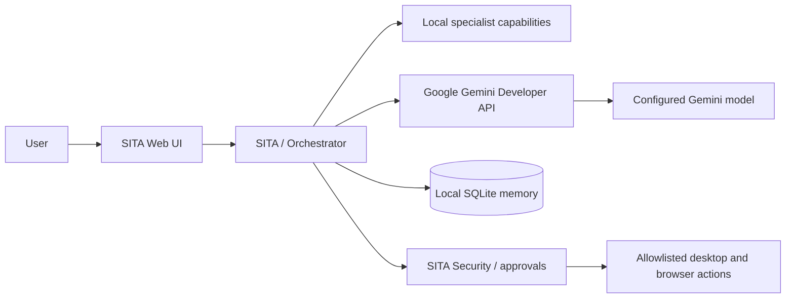

### 2. Specialist capability map — integrated packages

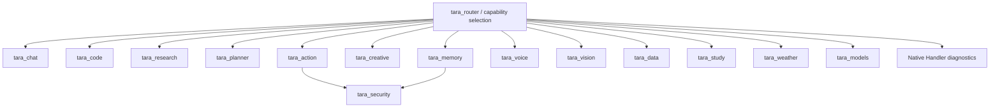

### 3. Inference routing — direct Gemini API boundary

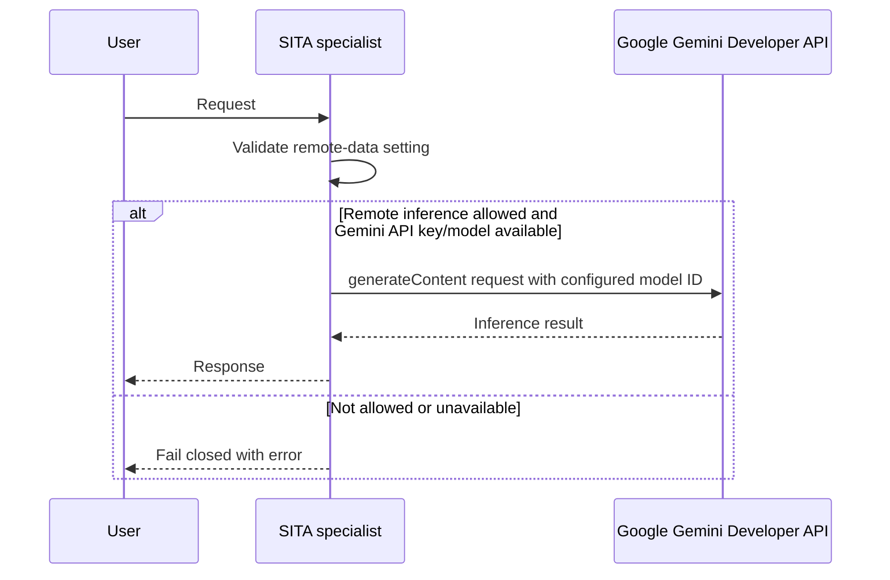

### 4. Conversation request lifecycle — conceptual

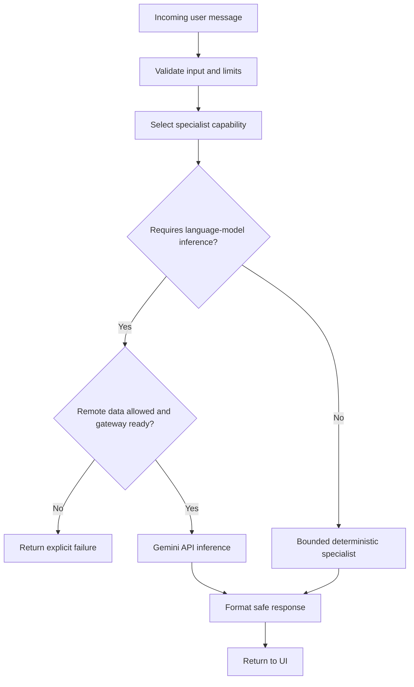

### 5. Permission and action approval — documented security boundary

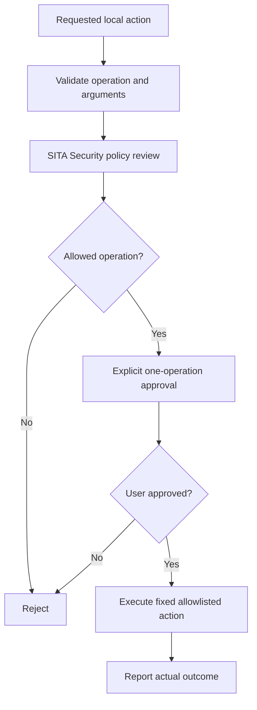

### 6. Memory mutation and read paths — conceptual

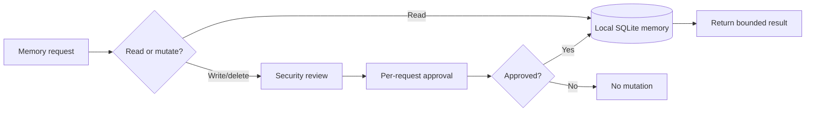

### 7. Desktop automation — allowlisted current scope

```mermaid
flowchart TD
  User[User request] --> Parse[Recognize supported action]
  Parse --> Sec[Security review and explicit approval]
  Sec --> Allowed{Approved?}
  Allowed -- No --> Stop[Do not launch]
  Allowed -- Yes --> Kind{Action type}
  Kind -- App --> Fixed[Fixed OS command: Calculator / Notepad / Paint]
  Kind -- Website --> URL[Validate HTTP(S) URL]
  URL --> Browser[System default browser]
  Fixed --> Status[Report result or unavailability]
  Browser --> Status
```

### 8. Native Handler diagnostic — current boundary

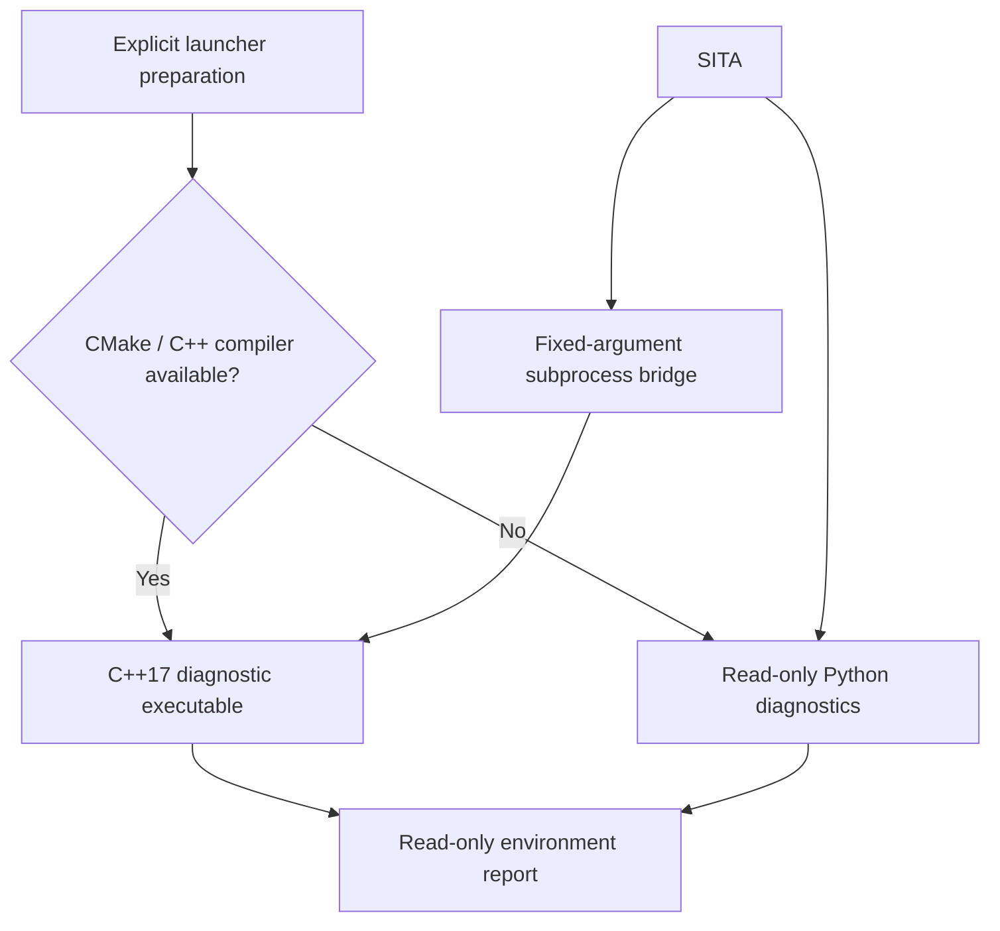

### 9. Source and data boundaries — documented behavior

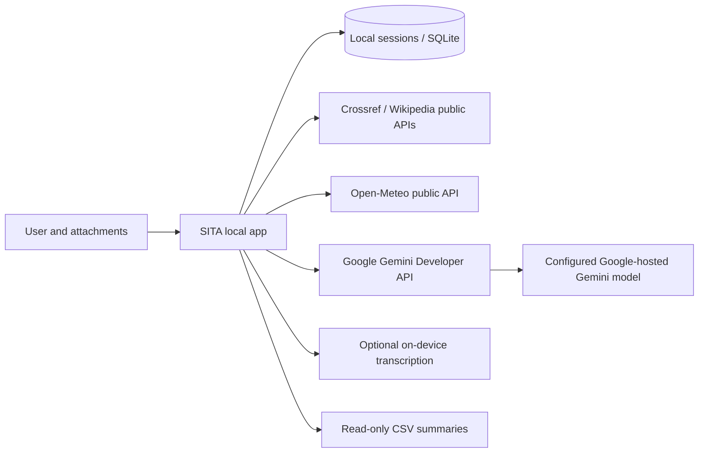

### 10. Model, runtime and tool taxonomy

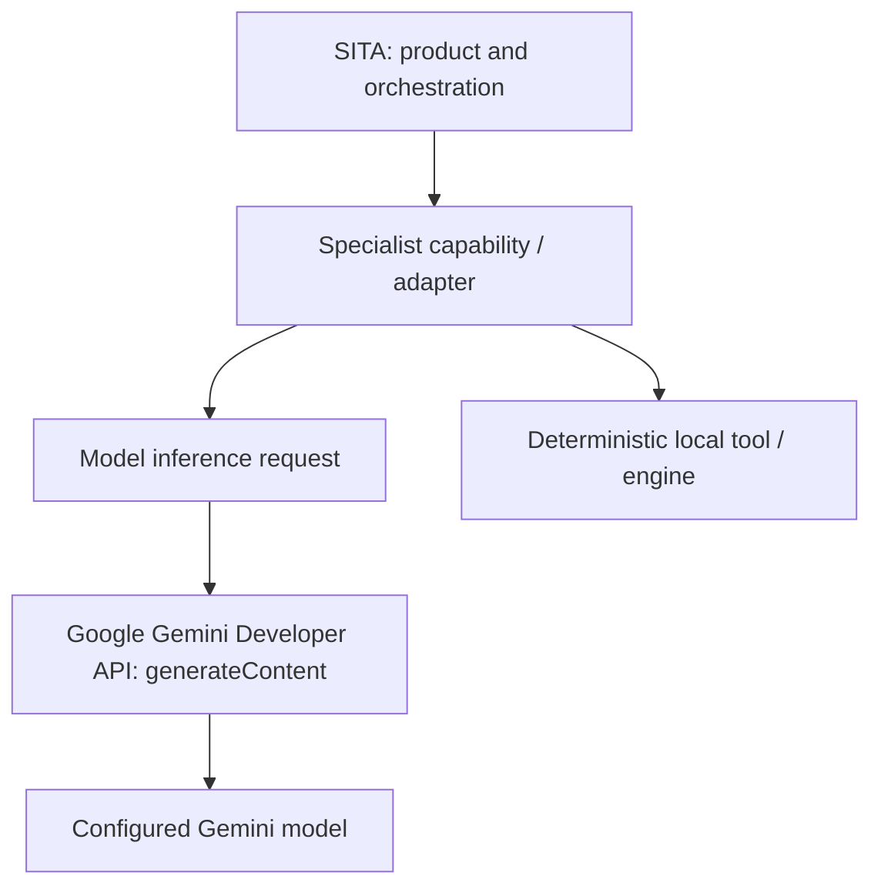

### 11. Deployment and startup — documented paths

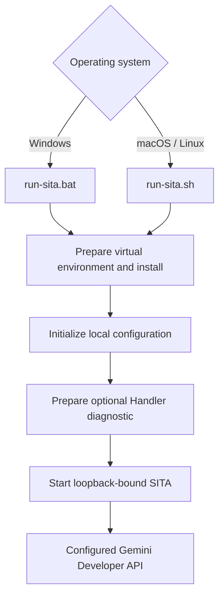

### 12. Target-only future sandboxed coding workflow — not implemented

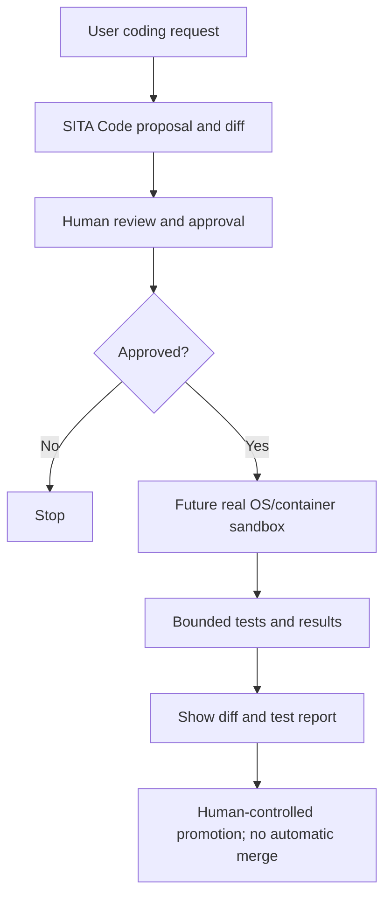

> **Status note:** Diagram 12 is a **target architecture only**. The current SITA Code module produces review-first proposals and does not execute code. All diagrams are explanatory representations, not a substitute for security tests or live integration verification.


## Complete feature and neural-network diagrams

For the full feature-by-feature architecture reference—including specialist workflows, Chat and memory, Code safety boundary, Research, Planner, security and approvals, Handler, MCP and Skills, Windows floating pet, Voice, Vision, Study, Data, Weather, Model Hub, deployment, failure handling, and conceptual Transformer neural-network diagrams—see **[Feature & Neural-Network Diagrams](docs/FEATURE_AND_NEURAL_NETWORK_DIAGRAMS.md)**.

> Neural-network diagrams are generic Transformer illustrations for the provider-hosted model behind Gemini API. SITA does not claim to implement or train a neural network or own model weights. Feature status and verification gaps remain tracked in [Remaining Features](docs/REMAINING_FEATURES.md).


## Token-efficient context and MCP metadata

SITA Chat now builds a bounded request context using a dependency-free UTF-8 token estimate. The current user request and system instructions are reserved first; recent history and relevant saved memories are optional, priority-ranked sections that are omitted whole when they do not fit. The estimate is exposed separately from actual provider usage. When Gemini API returns usage metadata, SITA captures the reported prompt, completion and total token counts; missing usage remains unknown. The default completion budget remains 1,536 tokens and the initial input-context budget is configurable in the chat runtime constructor (12,000 estimated tokens by default).

MCP tool discovery caches read-only tool metadata for 20 seconds by default to avoid repeatedly starting stdio servers for the same catalogue. Cache entries are scoped to each server configuration and can be explicitly invalidated. MCP tool descriptions, JSON schemas and returned text have bounded sizes to prevent oversized metadata/results from flooding model context. Tool calls are not cached; approval grants remain one-shot and audit-gated. Set the MCP tool gateway's `tool_cache_ttl_seconds=0` to disable metadata caching.
